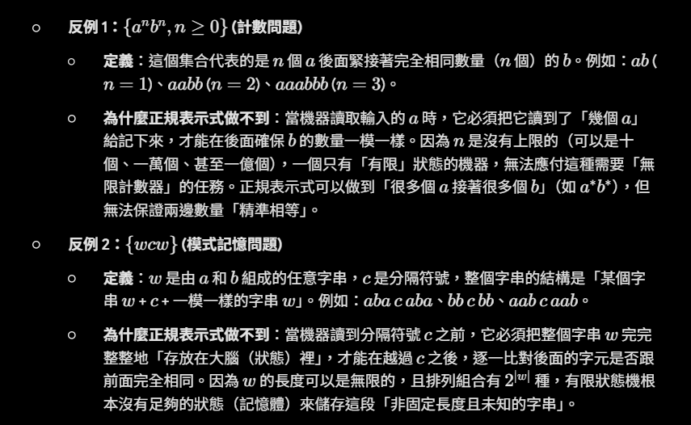

## 詞法分析的主要任務 (Main Task)
- 詞法分析器 (Scanner) 會讀取輸入的字元，將其分組為詞彙 (Lexemes)。
- 詞法分析器會產生詞符 (Tokens) 序列，以作為語法分析 (Syntax analysis) 階段的輸入。
## 核心概念：Lexemes, Patterns 與 Tokens
- **Lexemes (詞彙)**:符合特定樣式 (Pattern) 的字元序列。例如在 position = initial + rate * 60 這段程式碼中，position、= 與 initial 等皆為詞彙。
- **Patterns (樣式)**:  描述對應到相同 Token 的字串集合規則。例如 id (識別字) 的規則為「以字母開頭，後接字母或數字」。
- **Tokens (詞符)**:通常以 <token-name, attribute-value> 的格式表示。例如 <id, 1> <=> <id, 2> <+> <id, 3> <*> <60>。 
## 兩大核心問題與解決方案
- 若要表示或描述 Pattern，應使用正規表示式 (Regular expression)。
- 若要有效率地將輸入字串與預先定義的 Pattern 進行匹配，應使用有限狀態機 (Finite automata)。
## 字串 (Strings) 相關定義與運算
- **Alphabet (字母表)**: 有限的符號或字元集合。
- **String (字串)**：從字母表中選出的有限符號序列。字串 $S$ 的長度表示為 $\vert{}S\vert{}$，空字串則表示為 $\varepsilon$。
- **Concatenation (串接)**：字串 $x$ 與 $y$ 串接為 $xy$。包含空字串的串接規則為 $\varepsilon x = x \varepsilon = x$。
- **Exponentiation (指數/重複)**：將字串的串接視為乘積，規則定義為 $s^0 = \varepsilon$，且當 $i > 0$ 時 $s^i = s^{i-1}s$。
## 字串的組成部分 (以 "banana" 為例)
- **Prefix (前綴)**：從字串尾部移除零個或多個符號。例如 "ban"、"banana" 或 $\varepsilon$。
- **Suffix (後綴)**：從字串開頭移除零個或多個符號。例如 "nana"、"banana" 或 $\varepsilon$。
- **Substring (子字串)**：從字串中刪除任意前綴與後綴。例如 "nan"、"banana" 或 $\varepsilon$。  
- **Subsequence (子序列)**：刪除零個或多個不一定連續位置的符號。例如 "baan"。
- **Proper (真)**：不為空字串 $\varepsilon$ 且不等於原字串本身的前綴、後綴、子字串或子序列。
## 語言 (Language) 及其集合運算
- **Language (語言)**：基於固定字母表建立的任意可數之字串集合。
- **Concatenation (串接)**：$LM = \{st \mid s \in L \text{ and } t \in M\}$。其中 $L^0 = \{\varepsilon\}$，且當 $i > 1$ 時 $L^i = LL^{i-1}$。
- **Closure (閉包)**：$L^*$ 代表 Kleene closure (克林閉包)，$L^+$ 代表 Positive closure (正閉包)，兩者關係為 $L^* = L^+ \cup \{\varepsilon\}$。
- **應用範例**：C 語言的變數名稱可由 $L_1$ (大小寫英文字母與底線) 與 $L_2$ (數字、大小寫英文字母與底線) 組成。該變數名稱規則可表示為 $L_{cid} = L_1 L_2^*$。
## 正規表示式 (Regular Expressions) 核心概念
- 正規表示式 $r$ 所代表的語言 $L(r)$ 被稱為正規語言 (Regular language)。
- **基本規則 (Basis)**: $\varepsilon$ 是一個正規表示式，且 $L(\varepsilon)$ 為 $\{\varepsilon\}$；若 $a$ 為一個符號，則 $a$ 也是正規表示式，其 $L(a)$ 為 $\{a\}$。 
- **歸納規則 (Induction)：**
    - $r\vert{}s$ 代表聯集，即 $L(r) \cup L(s)$。
    -  $rs$ 代表串接，即 $L(r)L(s)$。  
    - $r^*$ 代表閉包，即 $L(r)^*$。 
- **優先權 (Precedence) (由左至右結合)**：* (閉包) > 串接 (Concatenation) > | (聯集)。
## 代數定律 (Algebraic Laws)
- **交換律 (Communicative)**：$r\vert{}s = s\vert{}r$。
- **結合律 (Associative)**：$r\vert{}(s\vert{}t) = (r\vert{}s)\vert{}t$ 以及 $r(st) = (rs)t$。
- **單位元素 (Identity)**：$\varepsilon r = r \varepsilon = r$。
## 正規定義 (Regular Definitions)
- 為了方便起見，可以替特定的正規表示式命名，格式為 $d_i \rightarrow r_i$
- 每個 $d_i$ 必須是新的符號，且 $r_i$ 只能由字母表 $\Sigma$ 以及先前已定義的 $d_1$ 到 $d_{i-1}$ 所組成，藉此避免遞迴定義。   
- **識別字範例**：C 語言的 id 可定義為 letter_(letter_ | digit)*。
## 正規表示式的擴充語法 (Extensions)
- $r^+$：代表一個或多個實例 ($rr^*$)。
- $r?$：代表零個或一個實例 ($r\vert{}\varepsilon$)。
-  $[abc]$：字元類別 (Character classes)，等同於 $a\vert{}b\vert{}c$。
-   $[a-z]$：範圍表示，等同於 $a\vert{}b\vert{}c\vert{}\cdots\vert{}z$。
-   $[^ab]$：表示除了 $a$ 和 $b$ 以外的任何字元。
## 非正規集合 (Non-Regular Set)
- 並非所有的語言都能夠使用正規表示式來表示。
- 經典反例包含：$\{wcw\}$ (其中 $w$ 為 $a$ 與 $b$ 的字串) 以及 $\{a^nb^n, n \ge 0\}$。   
- 限制原因：如果語言需要「記憶」過去發生過的「非固定數量 (nonconstant amount)」資訊，就無法被正規表示式所識別。
- 反例